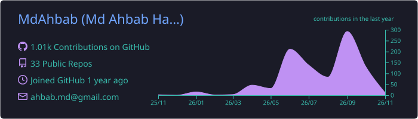
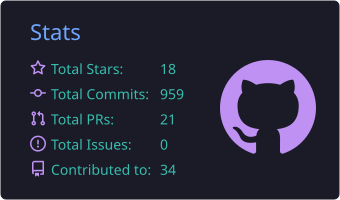
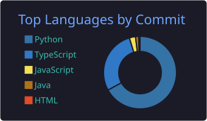

<!--
  ════════════════════════════════════════════════════════════════════
  Md Ahbab Hamid Khan — GitHub Profile README
  Lives in the repo MdAhbab/MdAhbab and renders on the profile page.
  Public repos link to their code; private ones say so and link to the
  live demo only (so no visitor ever hits a 404). Client work is marked
  as such — it's built by me, owned by the customer.
  Stats cards in ./profile-summary-card-output are regenerated daily by
  .github/workflows/profile-cards.yml. The snake lives on the `output`
  branch and is regenerated by .github/workflows/snake.yml.
  The header banner is ./.github/assets/header.svg (hand-made, so the
  blob can be large enough to keep the name readable in light mode).
  ════════════════════════════════════════════════════════════════════
-->

<!-- ░░░░░░░░░░░░░░░░░░░░  HEADER  ░░░░░░░░░░░░░░░░░░░░ -->

<a href="https://ahbab.tech">
  
</a>

<div align="center">

<a href="https://ahbab.tech">
  
</a>

<br/>

<a href="https://ahbab.tech"></a>
<a href="https://www.linkedin.com/in/mdahbab/"></a>
<a href="https://x.com/MdAhbab4"></a>
<a href="https://www.facebook.com/THEmdAhbab"></a>
<a href="https://instagram.com/the_maroonguy"></a>
<a href="mailto:ahbab.md@gmail.com"></a>

<br/>


<a href="https://github.com/MdAhbab?tab=followers"></a>


</div>

---

## `> whoami`

```yaml
ahbab@dhaka:~$ cat about.yml

name:        Md Ahbab Hamid Khan
role:        Full-Stack Engineer + Applied AI
studying:    BSc CSE (4th year) @ United International University
location:    Dhaka, Bangladesh
building:    radflow-edge  # 100% offline AI for chest-X-ray triage in rural clinics
exploring:   [computer vision, multi-agent LLM systems, energy-efficient AI infra]
cares_about: [AI-for-good, healthcare, developer tooling]
philosophy:  "Take it all the way to working software — not just a demo."
fun_fact:    "If it doesn't have a live link, I'm not done with it yet."
open_to:     collabs on AI-for-good, healthcare & dev-tooling projects
```

---

## Click something

> Don't take my word for it — these are live right now.

<div align="center">

<a href="https://fifa-wc-26-predictor.vercel.app"></a>
<a href="https://vitrine-ruby-five.vercel.app"></a>
<a href="https://duskdrop.vercel.app"></a>
<br/>
<a href="https://voxelforge-sage.vercel.app"></a>
<a href="https://shohay-zeta.vercel.app"></a>
<a href="https://untold-mystery-box-nu.vercel.app"></a>
<br/>
<a href="https://digonto-navigator.vercel.app"></a>
<a href="https://akash-investigator.vercel.app"></a>
<a href="https://orchestrator.ahbab.tech"></a>

</div>

---

## Featured work

<table>
<tr>
<td width="50%" valign="top">

### [radflow-edge](https://github.com/MdAhbab/radflow-edge)
Offline, edge-native AI that lets **a single rural health worker** run chest-X-ray triage — **no cloud, no internet**.

<sub>TypeScript · Python · Edge AI</sub><br/>
<a href="https://github.com/MdAhbab/radflow-edge"></a>


</td>
<td width="50%" valign="top">

### [OrchestratorCLI](https://github.com/MdAhbab/OrchestratorCLI)
Multi-agent orchestration — a central brain **routes work to parallel CLI coding agents** and stitches the results back together.

<sub>FastAPI · React · LLMs</sub><br/>
<a href="https://github.com/MdAhbab/OrchestratorCLI"></a>
<a href="https://orchestrator.ahbab.tech"></a>

</td>
</tr>
<tr>
<td width="50%" valign="top">

### [GridWise](https://github.com/MdAhbab/karen-bachao)
Smart-campus energy: an LLM reads operators' plain-English notes into directives, then a **linear program** finds the cheapest 24-hour schedule that obeys every one.

<sub>FastAPI · SciPy (HiGHS) · Gemini · Groq</sub><br/>
<a href="https://github.com/MdAhbab/karen-bachao"></a>
<a href="https://karenbachao.vercel.app"></a>

</td>
<td width="50%" valign="top">

### [vitrine](https://github.com/MdAhbab/vitrine)
A software marketplace run by a **fleet of cooperating AI agents** — curation, search and recommendations.

<sub>FastAPI · React · OpenAI</sub><br/>
<a href="https://github.com/MdAhbab/vitrine"></a>
<a href="https://vitrine-ruby-five.vercel.app"></a>

</td>
</tr>
<tr>
<td width="50%" valign="top">

### [ALink](https://github.com/MdAhbab/ALink)
Connects Bangladeshi students with **alumni at top global companies** — mentorship, referrals and jobs.

<sub>React · FastAPI · scikit-learn · RabbitMQ</sub><br/>
<a href="https://github.com/MdAhbab/ALink"></a>
<a href="https://alink-five.vercel.app"></a>

</td>
<td width="50%" valign="top">

### [Neuzo-News-Bot-AI](https://github.com/MdAhbab/Neuzo-News-Bot-AI)
Aggregates, **fact-checks** and synthesizes the news by cross-referencing sources with NLP.

<sub>Flask · React · Sentence-Transformers</sub><br/>
<a href="https://github.com/MdAhbab/Neuzo-News-Bot-AI"></a>
<a href="https://neuzo-news-bot.vercel.app"></a>

</td>
</tr>
<tr>
<td width="50%" valign="top">

### [InsightNest](https://github.com/MdAhbab/InsightNest)
Academic-opportunity platform with **AI advisory agents** and role-based portals.

<sub>React · Spring Boot · MySQL</sub><br/>
<a href="https://github.com/MdAhbab/InsightNest"></a>
<a href="https://insightnest-five.vercel.app"></a>

</td>
<td width="50%" valign="top">

### [Fluxora](https://github.com/MdAhbab/Fluxora)
SaaS for running **urban apartment buildings** — residents, bills, maintenance, all in one place.

<sub>TypeScript · React · FastAPI</sub><br/>
<a href="https://github.com/MdAhbab/Fluxora"></a>
<a href="https://fluxora-rust.vercel.app"></a>

</td>
</tr>
</table>

---

## Hackathons &amp; competitions

<table>
<tr>
<td width="33%" valign="top">

<sub><b>bKash presents SUST CSE Carnival 2026</b><br/>Codex Community Hackathon · AI/API SupportOps Challenge</sub>

### [Akash Investigator](https://github.com/MdAhbab/akash)
A fintech complaint copilot: reads a complaint + transaction history, works out **what actually happened**, routes it to the right team and drafts a safe multilingual reply — never asks for a PIN/OTP or promises a refund.

<sub>FastAPI · Pydantic · Gemini · MCP · React · Three.js</sub><br/>
<a href="https://github.com/MdAhbab/akash"></a>
<a href="https://akash-investigator.vercel.app"></a>

</td>
<td width="33%" valign="top">

<sub><b>Kaggle · Build With Gemma @ Bangladesh</b><br/>Local Language + Autonomous Agent tracks</sub>

### [Digonto · দিগন্ত](https://github.com/MdAhbab/Digonto)
A free, **Bangla-first** study-abroad &amp; visa navigator on Gemma 4 — so a student in Rangpur doesn't pay a consultancy a semester's tuition for advice. Every answer is cited; no source means it refuses instead of guessing.

<sub>Gemma 4 · Ollama · FastAPI · Qdrant · Redis · React</sub><br/>
<a href="https://github.com/MdAhbab/Digonto"></a>
<a href="https://digonto-navigator.vercel.app"></a>

</td>
<td width="33%" valign="top">

<sub><b>DataCamp competition</b><br/>→ turned into a public product</sub>

### [World Cup 26 Predictor](https://github.com/MdAhbab/FIFA-WC-26-predictor)
I took my competition model (Elo + Poisson) and shipped it as an app where anyone can **build a bracket and vote** on who lifts the trophy. Every score on screen comes from the model.

<sub>React · FastAPI · scikit-learn</sub><br/>
<a href="https://github.com/MdAhbab/FIFA-WC-26-predictor"></a>
<a href="https://fifa-wc-26-predictor.vercel.app"></a>

</td>
</tr>
</table>

## Client work

> Built by me, owned by the customer — running in production for real users.

| Product | What I built | Stack |
|---|---|---|
| **[alexa.com.bd](https://alexa.com.bd)** · [live ↗](https://alexa.com.bd) | Production e-commerce platform for a client — real-time alerts, loyalty points, Stripe checkout &amp; async invoicing | Django · React · Redis |

---

## Fresh off the keyboard

> My newest full-stack builds — all have a live demo, and dashboards open without login.

| Project | What it does | Stack |
|---|---|---|
| **[DuskDrop](https://github.com/MdAhbab/DuskDrop)** · [live ↗](https://duskdrop.vercel.app) | Surplus food at **time-decaying** discounts — live map, countdowns, vendor console | React · FastAPI · Three.js · MapLibre · GSAP |
| **[VoxelForge](https://github.com/MdAhbab/VoxelForge)** · [live ↗](https://voxelforge-sage.vercel.app) | Made-to-order 3D printing — in-browser **parametric** configurator, real-time volumetric pricing, printability checks | React · Three.js (r3f) · FastAPI · GSAP |
| **[Shohay](https://github.com/MdAhbab/Shohay)** · [live ↗](https://shohay-zeta.vercel.app) | Relief-donation **transparency** for Bangladesh — every pledge tracked to distribution, division → upazila, on a live map | React · FastAPI · Three.js · MapLibre |
| **[Untold](https://github.com/MdAhbab/Untold)** · [live ↗](https://untold-mystery-box-nu.vercel.app) | Budget + taste tags → a **constraint solver** packs a themed mystery box → scroll-driven 3D reveal | React · Three.js · FastAPI · GSAP |

<details>
<summary><b>Even more</b> — research, bioinformatics, e-commerce, collabs &amp; coursework</summary>

<br/>

| Project | What it does | Stack |
|---|---|---|
| **iOmicsLab** · [live ↗](https://iomics.org) | Bioinformatics lab site with a WebGL central-dogma story + admin CMS · <sub>private repo</sub> | React · FastAPI · Three.js |
| **[MCP_Server_Benchmarks](https://github.com/MdAhbab/MCP_Server_Benchmarks)** | Benchmarks for energy-efficient MCP server architectures | Python · Research |
| **[WasteBins](https://github.com/MdAhbab/WasteBins)** · [live ↗](https://wastebins.vercel.app) | Waste-collection routing (Random Forest + traffic-aware Dijkstra) | Python · scikit-learn |
| **[Oasis](https://github.com/MdAhbab/Oasis)** · [live ↗](https://oasis-brown.vercel.app) | Online art marketplace with auctions, bidding &amp; ownership history | Python · MySQL · Tailwind |
| **[De-Novo](https://github.com/MdAhbab/De-Novo)** · [live ↗](https://de-novo-jet.vercel.app) | Accessible communication platform for people with disabilities | JavaScript · Django · GCP |
| **SentinelGuard** · [live ↗](https://sentinelguard-eight.vercel.app) | Security-as-a-Service — AI guard rostering, QR patrol logs, hash-chained audit trail · <sub>private repo</sub> | Express · React · TypeScript |
| **Complete Legal Aid** · [live ↗](https://complete-legal-aid.vercel.app) | Legal-tech for Bangladesh — verified lawyers, evidence vault, bilingual AI assistant · <sub>team collab</sub> | Django · React · MySQL |
| **KreatOS** · [live ↗](https://kreatos-rosy.vercel.app) | Multi-tenant creator CMS &amp; multi-platform publisher · <sub>team collab</sub> | Next.js · React · TypeScript |
| **[H.E.X](https://github.com/MdAhbab/H.E.X)** | JavaFX desktop app bundling small but genuinely useful tools | Java |
| **[OOP-Fundamentals](https://github.com/MdAhbab/OOP-Fundamentals)** | Progressive OOP curriculum &amp; exercises | Java · Python |
| **[Intro-to-HTML-CSS-JavaScript](https://github.com/MdAhbab/Intro-to-HTML-CSS-JavaScript)** · [live ↗](https://mdahbab.github.io/Intro-to-HTML-CSS-JavaScript/) | Beginner-friendly front-end learning blog | HTML · CSS · JS |
| **[Django-LittleLemon](https://github.com/MdAhbab/Django-LittleLemon-Restaurant-by-Meta)** | Restaurant API for the Meta Django certificate | Python · Django |

</details>

---

## What I build with

<div align="center">


<br/>

<br/>

<br/>


<br/><br/>


</div>

---

## By the numbers

<div align="center">

<!-- Generated daily by .github/workflows/profile-cards.yml — no third-party server needed -->






</div>

---

## Watch the snake eat my commits

<div align="center">

<picture>
  <source media="(prefers-color-scheme: dark)" srcset="https://raw.githubusercontent.com/MdAhbab/MdAhbab/output/github-contribution-grid-snake-dark.svg">
  <source media="(prefers-color-scheme: light)" srcset="https://raw.githubusercontent.com/MdAhbab/MdAhbab/output/github-contribution-grid-snake.svg">
  
</picture>

</div>

---

## In the lab

> Research-flavoured ideas I'm designing toward. Repos open as each one becomes real — watch this space.

| Project | The idea | Direction |
|---|---|---|
| **NeuroLens** | Visualise the attention circuits inside transformer models | PyTorch · TransformerLens · Plotly |
| **Synapse** | Type-safe RAG — compile schemas into prompt-aware retrievers | TypeScript · pgvector · LLMs |
| **Atlas-VLM** | A vision-language model that actually understands scientific diagrams | JAX · CLIP · LoRA |
| **DiffPose** | Diffusion-based 3D human pose from a single phone video | PyTorch · Diffusers · MMPose |

---

## Away from the keyboard

<div align="center">


<br/>


<sub>Yes, the football obsession is why the World Cup predictor exists.</sub>

</div>

---

<div align="center">

### Let's build something

Got an idea in **AI-for-good**, **healthcare**, or **developer tooling**? I'm in.

<a href="https://ahbab.tech"></a>
<a href="mailto:ahbab.md@gmail.com"></a>
<a href="https://www.linkedin.com/in/mdahbab/"></a>

<br/><br/>

<sub>If something here helped you, a star genuinely makes my day.</sub>

</div>


